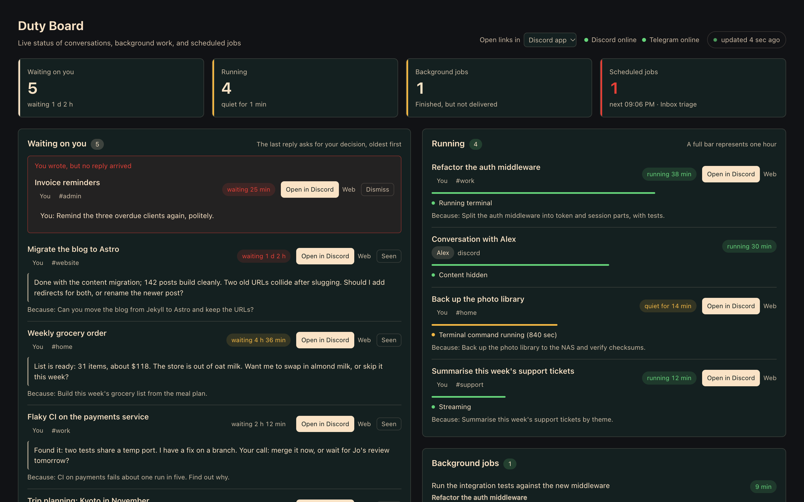

<div align="center">

# Hermes Duty Board

**Hermes のすべての会話から、あなたの対応待ちを 1 枚のライブダッシュボードに集約します。**

[English](README.md) · [简体中文](README.zh-CN.md) · 日本語



</div>

[Hermes Agent](https://github.com/NousResearch/hermes-agent) を Discord・Telegram・Feishu で使っていると、会話はすぐに何十ものスレッドに散らばり、次のようなことを見落としがちになります。

- エージェントが 2 日前に質問して、まだ返事を待っている。
- 自分が送ったメッセージに、結局返信が来ていない。
- バックグラウンドジョブが終わった頃には元のスレッドが切り替わっていて、結果が届いていない。
- 定期ジョブが火曜日から静かに失敗し続けている。

Duty Board はこれらを 1 ページにまとめ、5 秒ごとに更新します。各会話にはボタンがあり、ワンクリックでその会話に戻れます。

## 表示される内容

| セクション | 内容 |
|---|---|
| **あなたの返信待ち** | 最後の返信があなたへの質問や判断待ちで終わっている会話。待ち時間が長い順に、何を聞かれたか・きっかけになった発言を表示します。 |
| **未返信** | 最後に発言したのがあなたで、実行中のターンもない会話。多くの場合、取りこぼされたメッセージです。 |
| **実行中** | いま進行中のターン。経過時間とエージェントが何をしているか（モデル応答待ち、ターミナル実行中など）を表示し、10 分以上動きがなければ警告します。 |
| **バックグラウンドジョブ** | 実行中の `delegate_task`。完了したのに元のセッションが切り替わっていて結果を届けられなかったものも一覧にします。 |
| **定期ジョブ** | エラー、配信失敗、一時停止、実行予定時刻の超過があるジョブと、次に実行されるジョブのタイムライン。 |
| **最近完了** | 直近 24 時間の返信のうち、質問ではなく報告で終わっているもの。「後で報告します」と約束した返信には印が付きます。 |
| **常設ゴール** | 実行中・一時停止中の `/goal`。ターン数と判定の直近の理由を表示します。 |

**すぐに飛べる**：「あなたの返信待ち」「未返信」「実行中」のカードには **Discord で開く** ボタンがあります。`discord://` で Discord デスクトップアプリの該当スレッドを開き、メッセージ ID が分かる場合はあなたの発言の位置まで移動します。ヘッダーの切り替えで、ブラウザで開くようにもできます。

**片付けたら消す**：「確認済み」を押すとカードを閉じます。その会話に新しいメッセージが来ると再び表示されます。

## 動作要件

- Hermes Agent **0.21 以降**と Web ダッシュボード（`hermes dashboard`）。
- Hermes が対応するメッセージングプラットフォームならどれでも使えます。ジャンプボタンは現在 Discord のみで、他のプラットフォームの会話はボタンなしで表示されます。

## インストール

```bash
hermes plugins install xiaoyaner0201/hermes-duty-board
hermes plugins enable duty-board
```

プラグインの API ルートはダッシュボード起動時にマウントされるため、インストール後にダッシュボードを再起動してください。

```bash
hermes dashboard --stop && hermes dashboard
```

ダッシュボードを開くと、*Sessions* の前に **Duty Board** タブが追加されています。

## 設定

設定はすべて任意です。既定値を変えたい場合は `~/.hermes/duty-board/settings.json`（`<HERMES_HOME>/duty-board/settings.json`）を作成します。

```json
{
  "owner": "123456789012345678",
  "hide_other_people_content": true,
  "people": { "123456789012345678": "自分", "234567890123456789": "田中" },
  "window_days": 7,
  "stall_seconds": 600
}
```

| キー | 既定値 | 意味 |
|---|---|---|
| `owner` | 未設定 | 「自分の会話」とみなすプラットフォームのユーザー ID。未設定なら、すべての会話が自分のものとして扱われ、何も隠されません。環境変数 `DUTY_BOARD_OWNER` でも指定できます。 |
| `hide_other_people_content` | `true` | `owner` を設定している場合、他の人の会話は「返信待ち」と「最近完了」に出しません。実行中のターンは「〇〇との会話」とだけ表示し、内容もリンクも出しません。 |
| `people` | `{}` | ユーザー ID ごとの表示名。未設定ならプラットフォーム上のユーザー名を表示します。 |
| `window_days` | `7` | 何日前までの会話を対象にするか。 |
| `stall_seconds` | `600` | 実行中のターンが何秒動きがなければ警告するか。 |
| `unanswered_grace_seconds` | `180` | あなたの最後のメッセージに何秒返信がなければ「未返信」に入れるか。 |
| `recent_done_hours` | `24` | 「最近完了」の対象時間。 |
| `goal_lookback_days` | `14` | これより古いゴールは件数だけを表示します。 |

## 「あなたの返信待ち」の判定方法

プラグインはモデルを一切呼びません。最後の返信のうち、意味のある最後の 1〜2 行だけを見ます（添付・リンク・脚注は除外）。そこに疑問符か、判断をあなたに委ねる表現（「よろしいですか」「教えてください」、英語・中国語の同様の表現）があるかを調べます。長い報告の途中にある質問は数えません。

経験則に基づく判定なので、ときどき誤判定があります。その場合は「確認済み」で閉じてください。現在は英語・中国語・日本語に対応しています。他の言語のパターンも歓迎します。

## プライバシーと安全性

- **読み取り専用**：`state.db` を SQLite の `mode=ro` で開き、ほかに `cron/jobs.json` と `gateway_state.json` を読むだけです。
- **書き込むのは 1 ファイルだけ**：自分用の非表示リスト `<HERMES_HOME>/duty-board/dismissed.json` だけを書きます。
- **ネットワーク通信なし・モデル呼び出しなし・認証情報に触れない**：`.env`、`auth.json` などトークンの保存場所は読みません。
- **ダッシュボードの認証の内側で動く**：API は他のダッシュボードプラグインと同じく `/api/plugins/duty-board/` にマウントされ、ダッシュボードへのログインが必要です。
- **Hermes の内部テーブルに依存**：読んでいるのは Hermes の内部テーブルで、外部向けに安定性が保証されたインターフェースではありません。将来のバージョンで構造が変わった場合、影響を受けたセクションは空になり警告が表示されますが、ページ全体は壊れません。その際は issue を立ててください。

## 多言語対応

UI はダッシュボードの言語設定に従います：English、简体中文、繁體中文、日本語。新しい言語は `dashboard/dist/index.js` 冒頭のメッセージカタログに 1 つ追加するだけです。キーの抜けは `tests/js/i18n_check.mjs` が検出します。

## 開発

```bash
python -m venv .venv && . .venv/bin/activate
pip install -r requirements-dev.txt
python -m pytest
node --check dashboard/dist/index.js && node tests/js/i18n_check.mjs
```

`dev/harness/` を使うと、Hermes なしで合成データの Hermes ホームを使ってこのタブを表示できます。上のスクリーンショットもこの方法で撮っています。詳しくは [dev/README.md](dev/README.md) を参照してください。

## コントリビュート

issue やプルリクエストを歓迎します。手順は [CONTRIBUTING.md](CONTRIBUTING.md) を参照してください。セキュリティ上の問題は [SECURITY.md](SECURITY.md) に従って非公開で報告してください。

## ライセンス

[Apache-2.0](LICENSE)
